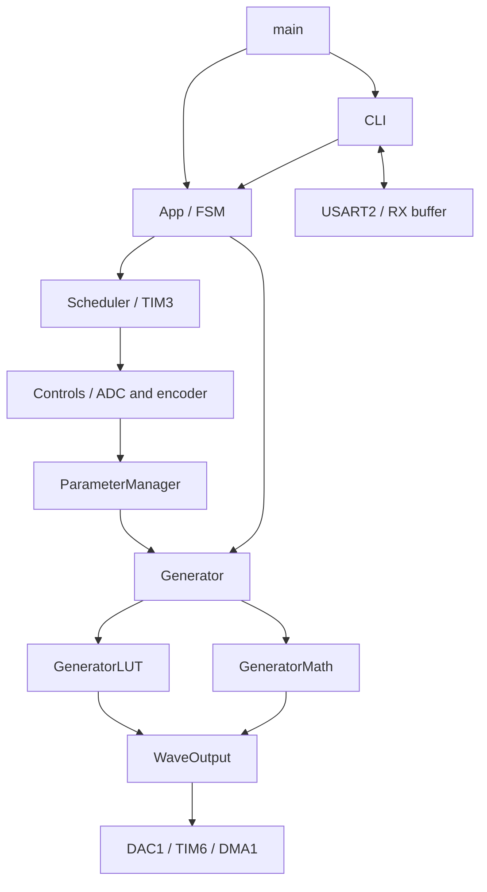
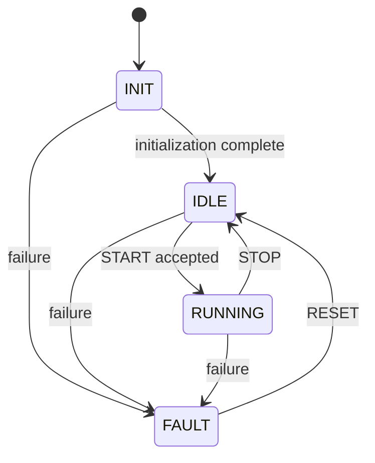

# Architecture

## Main execution flow

`main()` initializes System, GPIO, App, and CLI. The main loop runs `App_Run()` and `CLI_Run()` cooperatively.

## Module responsibilities

| Module | Contract |
|---|---|
| App | Coordinates the FSM, LOCAL/REMOTE ownership, and application faults |
| FSM | Validates state transitions; STOP does not clear FAULT |
| Scheduler | Reads TIM3 ticks and runs controls every 50 ms in foreground; skips missed periods |
| Controls | Reads frequency/amplitude/offset ADC channels and encoder delta |
| ParameterManager | Filters, quantizes, waits for three matching observations, then applies stable settings |
| Generator | Provides shared configuration, validation, and backend selection |
| GeneratorLUT | Owns constant tables and a private RAM buffer; stops output before modifying the buffer |
| GeneratorMath | Owns phase state and the sample computation callback |
| WaveOutput | Coordinates DAC, TIM6, and DMA; excludes simultaneous DMA and ISR generation |
| CLI | Parses text in foreground; the USART2 IRQ only captures received data |
| Protocol / CRC8 | Standalone binary codec, not integrated with the CLI |

## States

In REMOTE mode, START begins generation with the configured settings. In LOCAL mode, START arms the application and stable readings start the waveform later; RUNNING alone does not prove the DAC is already generating. Changing SOURCE or editing remote parameters requires IDLE. STOP leaves FAULT active; RESET is only accepted in FAULT.

## Sampling and controls

PC0 uses five linear segments spanning successive frequency bands. ParameterManager filters the ADC, holds its accepted position within a five-count deadband, quantizes the frequency, and applies three matching observations only if effective settings differ from the last applied settings. TIM3 schedules these observations every 50 ms. PC1 and PB0 retain their existing amplitude and offset processing. See [the current transfer curve and TIM6 examples](../README_PATCH_50KHZ.md#local-frequency-control).

Both backends use SamplePlan at START. LUT uses circular DMA with a decimated table; MATH refills alternating DMA half-buffers. TIM6 uses its prescaler and reload register to approximate the requested sample rate from an 84 MHz timer clock.

## Concurrency

Parameters and buffers are changed in foreground after stopping the output. TIM3 updates a volatile 32-bit tick counter. USART2 uses a 128-byte RX ring buffer with one reserved slot. DMA half-transfer and transfer-complete events drive the MATH refill callback. Each interrupt handler must have exactly one definition.

Configured interrupt priorities are TIM6 = 5, TIM3 = 6, and USART2 = 7. Timing and sample loss require hardware validation; these priorities do not demonstrate that real-time deadlines are met.
