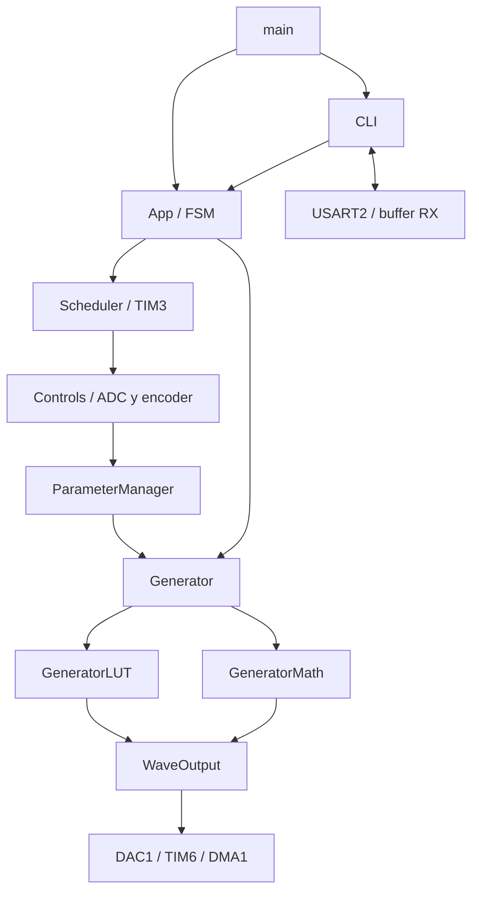
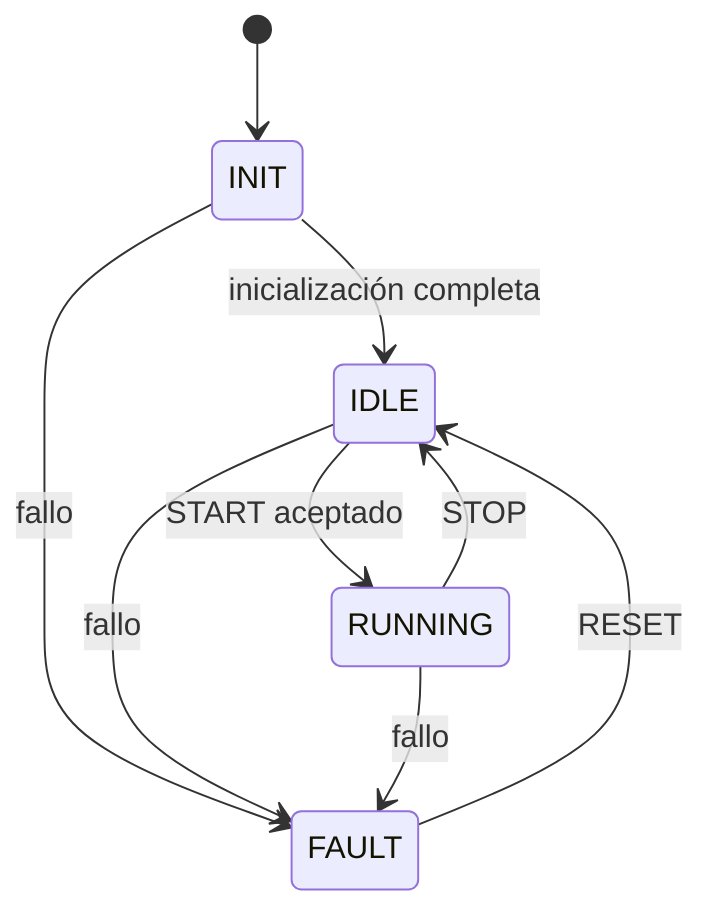

# Arquitectura

## Flujo principal

`main()` inicializa System, GPIO, App y CLI. El bucle principal ejecuta `App_Run()` y `CLI_Run()` de forma cooperativa.

## Responsabilidades

| Módulo | Contrato |
|---|---|
| App | Coordina FSM, origen LOCAL/REMOTE y fallos de aplicación |
| FSM | Valida transiciones; STOP no borra un FAULT |
| Scheduler | Consulta ticks de TIM3 y ejecuta controles cada 50 ms en foreground; omite periodos atrasados |
| Controls | Lee ADC de frecuencia/amplitud/offset y delta del encoder |
| ParameterManager | Filtra, cuantiza, espera tres lecturas iguales y aplica una configuración estable |
| Generator | API común de configuración, validación y selección de backend |
| GeneratorLUT | Tablas constantes y buffer RAM privado; detiene salida antes de modificarlo |
| GeneratorMath | Estado de fase y callback de cálculo de muestras |
| WaveOutput | Coordina DAC, TIM6 y DMA; excluye DMA y generación por ISR |
| CLI | Interpreta texto en foreground; USART2 IRQ solo captura recepción |
| Protocol / CRC8 | Codec binario independiente, sin integración con CLI |

## Estados

En REMOTE, START inicia la generación configurada. En LOCAL, START arma la aplicación y las lecturas estables inician la señal posteriormente; RUNNING no demuestra por sí solo que el DAC ya esté generando. Cambiar SOURCE o editar parámetros remotos requiere IDLE. STOP deja un FAULT activo; RESET solo es válido en FAULT.

## Muestreo y control

- TIM6 usa un intervalo redondeado: `ticks = round(16 MHz / Fs)` y `ARR = ticks - 1`, con PSC = 0. La implementación acepta ticks de 2 a 65536.
- Para LUT y MATH se solicita `Fs = round(frecuencia * 256)`. La frecuencia real depende del intervalo entero aceptado por TIM6.
- LUT transfiere muestras de RAM al DAC mediante DMA1 Stream5 Channel7 en circular.
- MATH usa TIM6 IRQ y un callback para preparar la siguiente muestra del DAC. Falta medir latencia y desfase inicial en banco.
- TIM3 genera ticks de 10 ms. Los controles se consultan cada 5 ticks, sin ejecutar ADC ni lógica de aplicación dentro de TIM3 IRQ.
- Los potenciómetros usan IIR con alfa 0.18 y cuantización de 1 Hz / 0.1 V. Tres lecturas estables reducen cambios por ruido; no garantizan inmunidad al ruido real.
- El encoder selecciona DC, SINE, TRIANGLE y SQUARE, con cuatro cuentas por paso lógico.

## Concurrencia

Los parámetros y buffers se cambian en foreground tras detener la salida. TIM3 actualiza un contador volatile de 32 bits. USART2 implementa un buffer circular RX de 128 bytes con un espacio reservado. TIM6 llama al proveedor de muestras solo en MATH. Debe existir una sola definición de cada handler.

Prioridades configuradas: TIM6 = 5, TIM3 = 6 y USART2 = 7. El rendimiento y la pérdida de muestras requieren validación física; estas prioridades no constituyen evidencia de cumplimiento temporal.
